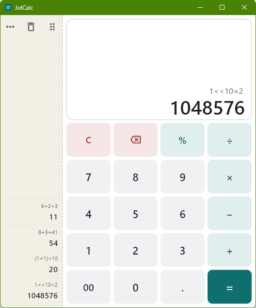

# JotCalc

A tape-style calculator for Android, Windows x64, and the web with a persistent history sidebar, built for quick, throwaway bookkeeping.

The Windows app shows the current expression and result above the keypad. From the history sidebar, you can reopen past calculations or copy their results.

