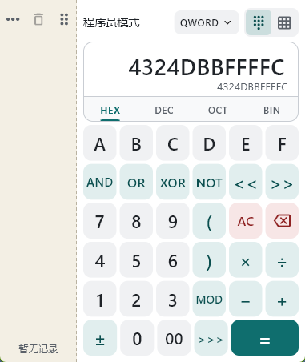
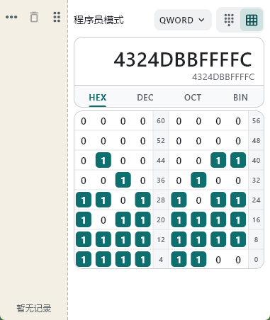

# JotCalc

A tape-style calculator for Android, Windows x64, and the web, with Standard and Programmer modes and a history sidebar.

[Download the latest release](https://github.com/qcbf/JotCalc/releases/latest)

## Screenshots

<p>
  
  
  
</p>

## Features

- **Standard mode** previews results as you enter arithmetic expressions and percentages.
- **Programmer mode** converts between HEX, DEC, OCT, and BIN. Work with 8-, 16-, 32-, or 64-bit integers, apply bitwise operations and shifts, and toggle individual bits in the bit editor.
- **History** is saved locally by default. Click or tap an entry to copy its result, or double-click or double-tap to reopen the calculation. Drag to resize the sidebar or hide it in Settings.
- **Preferences** include light, dark, and system themes and a choice of English or Simplified Chinese.

Switch modes under **Settings → Calculator mode**. On Windows, use **Alt+1** for Standard or **Alt+2** for Programmer.

## Install

| Platform | Setup |
| --- | --- |
| Android | Install the APK matching your device's architecture. Most recent Android phones use `arm64-v8a`. |
| Windows 10 or 11 (x64) | Extract the entire Windows ZIP and open `JotCalc.exe`. |
| Web | Extract the Web ZIP and serve its contents from a web server. |

## Run from source

Install Flutter and set up your target platform. [Flutter installation guide](https://docs.flutter.dev/install)

```sh
git clone https://github.com/qcbf/JotCalc.git
cd JotCalc
flutter pub get
flutter run
```

Use `flutter run -d windows` for Windows or `flutter run -d chrome` for the web. For Android, select a connected device or emulator.

For packaging and web hosting, see the [build guide](tool/README.md).

## License

[MIT License](LICENSE)
